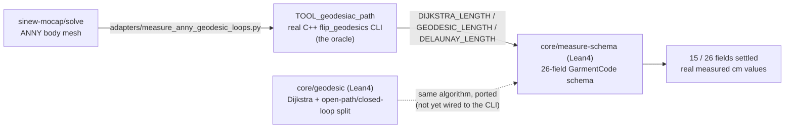

# measure — sinew-mocap

CI

**A tape measure that actually follows the surface — formalized in Lean 4, checked against a real geodesic tool.**

A flat plane cut through a body mesh is not what a tailor's tape reads, and most measurement pipelines settle for it anyway.



Read it left to right: the real mesh goes into the real C++ tool through a Python adapter, the tool's measured lengths fill the 26-field schema, and the Lean 4 `core/geodesic` package is a from-scratch formal port of that same algorithm, tested on its own.

```sh
cd core/geodesic/lean && lake build && lake exe geodesic_test
cd core/measure-schema/lean && lake build && lake exe measure_schema_report
```

Run that to see today's 15 of 26 settled fields, backed by real measured numbers, not placeholders.

The sections below hold what is ported, what is not yet, why open paths and closed loops can never share one straightening step, and the sibling repos to clone: `docs/STATUS.md`.
