# measure — sinew-mocap

CI

**A tape measure that actually follows the surface — formalized in Lean 4, checked against a real geodesic tool.**

A flat plane cut through a body mesh is not what a tailor's tape reads, and most measurement pipelines settle for it anyway.

```mermaid
flowchart TB
    subgraph HEAD["Head"]
        height["height\n(axis extent)"]
        head_l["head_l\n(surface distance)"]
    end
    subgraph NECK["Neck"]
        neck_w["neck_w\n(surface distance)"]
    end
    subgraph SHOULDER["Shoulders"]
        shoulder_w["shoulder_w\n(surface distance)"]
        shoulder_incl["shoulder_incl\n(angle)"]
    end
    subgraph BUST["Bust / chest"]
        bust["bust\n(circumference loop)"]
        bust_line["bust_line\n(height marker)"]
        bust_points["bust_points\n(landmark)"]
        vert_bust_line["vert_bust_line\n(height marker)"]
        underbust["underbust\n(circumference loop)"]
        armscye_depth["armscye_depth\n(surface distance)"]
    end
    subgraph WAIST["Waist"]
        waist["waist\n(circumference loop)"]
        waist_line["waist_line\n(height marker)"]
        waist_back_width["waist_back_width\n(surface distance)"]
        waist_over_bust_line["waist_over_bust_line\n(height marker)"]
    end
    subgraph BACK["Back"]
        back_width["back_width\n(surface distance)"]
    end
    subgraph HIPS["Hips"]
        hips["hips\n(circumference loop)"]
        hips_line["hips_line\n(height marker)"]
        hip_back_width["hip_back_width\n(surface distance)"]
        hip_inclination["hip_inclination\n(angle)"]
        bum_points["bum_points\n(landmark)"]
        crotch_hip_diff["crotch_hip_diff\n(derived difference)"]
    end
    subgraph ARM["Arm"]
        arm_length["arm_length\n(surface distance, real: 47.30cm)"]
        arm_pose_angle["arm_pose_angle\n(angle)"]
    end
    subgraph WRIST["Wrist"]
        wrist["wrist\n(circumference loop)"]
    end
    subgraph LEG["Leg"]
        leg_circ["leg_circ\n(circumference loop)"]
    end

    HEAD --> NECK --> SHOULDER --> BUST --> WAIST --> BACK --> HIPS --> ARM --> WRIST --> LEG

    classDef settled fill:#bbf7d0,stroke:#16a34a,color:#14532d;
    classDef unsettled fill:#fecaca,stroke:#dc2626,color:#7f1d1d;
    class height,waist,bust,underbust,hips,leg_circ,wrist,arm_length,bust_line,waist_line,hips_line,shoulder_incl,hip_inclination,arm_pose_angle,crotch_hip_diff settled
    class shoulder_w,neck_w,back_width,hip_back_width,waist_back_width,head_l,armscye_depth,vert_bust_line,waist_over_bust_line,bust_points,bum_points unsettled
```



All 26 GarmentCode body-measurement fields, grouped head to foot by where they sit on the body. Green = settled with a real measured value today; red = still needs its landmark definition read from GarmentCode's own measurement PDF.

```sh
cd core/geodesic/lean && lake build && lake exe geodesic_test
cd core/measure-schema/lean && lake build && lake exe measure_schema_report
```

Run that to see today's 15 of 26 settled fields, backed by real measured numbers, not placeholders.

The sections below hold what is ported, what is not yet, why open paths and closed loops can never share one straightening step, and the sibling repos to clone: `docs/STATUS.md`.
