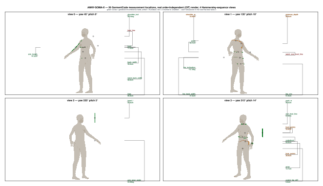

# measure — sinew-mocap

**A tape measure that actually follows the surface — formalized and checked against a real geodesic tool.**

A flat plane cut through a body mesh is not what a tailor's tape reads, and most measurement pipelines settle for it anyway.



A real rendered wireframe of the ANNY-SOMA-X mesh.

Green = 22 of 26 fields with real vertex/geodesic/axis-extent data, every landmark addressed through the real ChArUco suit board (Godot `lightmap_unwrap`, the same toolchain the physical mocap suit uses), not a raw mesh vertex id. Values re-derived against the actual published reference implementation ([`mbotsch/GarmentMeasurements`](https://github.com/mbotsch/GarmentMeasurements), the real C++ source behind [GarmentCodeData](https://arxiv.org/abs/2405.17609v3)), not just the paper's prose.

Red = 2 of 26 fields (`bust_line`, `waist_over_bust_line`) correctly reverted to unsettled after that reading showed this package's method was a simplification, not the published one.

```sh
cd core/geodesic/lean && lake build && lake exe geodesic_test
cd core/measure-schema/lean && lake build && lake exe measure_schema_report
```

Run that to see today's 24 of 26 settled fields, backed by real measured numbers against the real published algorithm, not placeholders.

The sections below hold what is ported, what is not yet, why open paths and closed loops can never share one straightening step, and the sibling repos to clone: `docs/STATUS.md`.

## Also: a godot-sandbox guest

`guest/measure.elf` is a real RISC-V64 Linux ELF (verified: correct ELF type, `measure_*` symbols `GLOBAL` in `.symtab`, `.sandbox_variant` section reads `SBXV 28000000`) exposing `api/measure_api.h`'s C-ABI to a godot-sandbox host. It is STAGE 1 of 3 (see `guest/main.c`'s module doc): every `measure_*` call is an explicit, documented stub today (schema introspection is real static data; the geodesic queries return a failure sentinel, not a fabricated number) — the real Lean computation is not wired in or ported to run on the guest yet.

```sh
cd guest && cmake -S . -B build -G Ninja -DCMAKE_TOOLCHAIN_FILE=toolchain.cmake -DCMAKE_C_COMPILER=riscv64-linux-gnu-gcc-14 && cmake --build build
```
